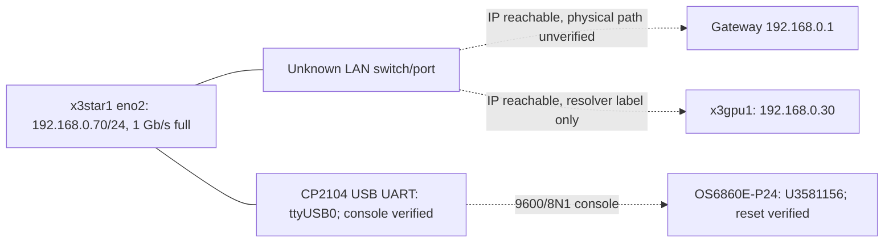
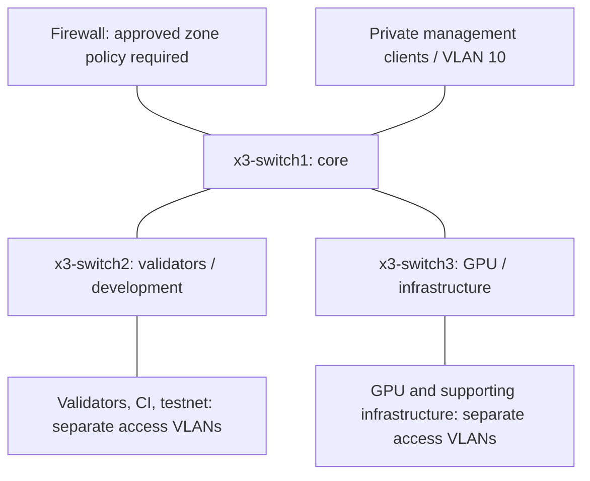

# Observed and proposed topology

Observed (remote switch identity unknown):

Proposed, not cabled/approved/implemented:

Lines in the proposal do not specify ports, LAGs or link speeds. All require physical
inspection. No routing or stacking is implied. Fibre Channel is excluded.
